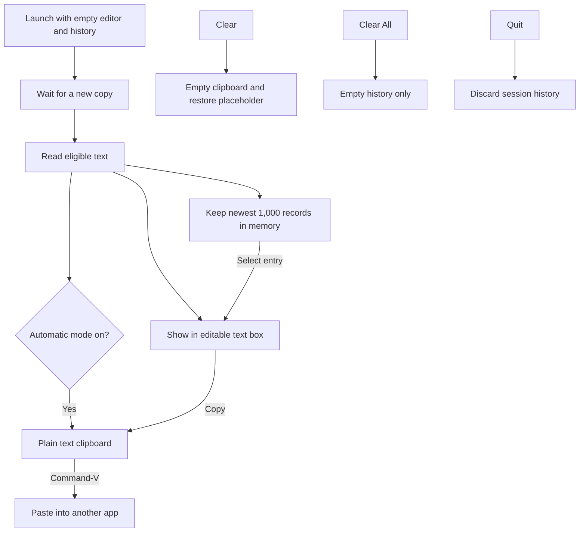

# Kopier

A native macOS clipboard editor that removes rich text formatting. All clipboard processing stays local.

## Use

Open `Kopier.app`. The 460 × 460 window starts with an empty editor and the placeholder “Copy any text and it will show here.” Your existing system clipboard stays untouched until a new copy occurs.

1. Copy text from any app. Kopier shows it in the editor and adds it to history.
2. Edit it if needed, then click **Copy**.
3. Return to your destination and press **Command-V**.

Automatic formatting removal starts checked. Fonts, colors, and rich text styles are removed; words, Unicode, and line breaks are preserved. Literal Markdown or HTML source remains text. Images and file copies without text are left alone. Common password-manager private clipboard markers are respected.

**Clear** empties the system clipboard and editor, restoring the placeholder. It keeps history. **Show History** opens the drawer; selecting an entry loads it into the editor so you can edit and **Copy** it. **Clear All** empties history only. **Hide History** closes the drawer.

History holds at most 1,000 text copies in memory, newest first, and discards the oldest when full. Quitting clears it. Nothing is saved to disk or sent over the network. Reusing an entry does not add a duplicate record. Entries wrap and resize with the window; separators appear only on actual entries.

**Kopier → About Kopier** shows the app icon, name, version, and release date on separate centered lines.

Click the pixel copier in the menu bar or the Dock icon to reopen the window. Quit with **Kopier → Quit Kopier**, **Command-Q**, or the Dock menu. Kopier does not paste into other apps automatically or require Accessibility permission.

**Kopier → Check for Updates…** uses Sparkle to check the GitHub-hosted release feed. Available updates download, verify their signature, and install inside the app, with a relaunch when you approve. Incremental patches are used when available, with a full-download fallback. Checks are manual; background checks, automatic installation, and system profiling are disabled. Clipboard text and history never enter the updater.

## Operation



## Build

Requires macOS 13 or later with Apple's Swift command line tools or Xcode. Sparkle 2.10.1 is the only third-party dependency. The first build downloads its official binary distribution and verifies a pinned SHA-256 checksum; later builds reuse the local `.build/` cache.

```sh
./build.sh
open Kopier.app
```

The build regenerates the pixel copier assets using `Scripts/MakeIcon.swift`, packages `Kopier.app`, and signs it locally. It is not notarized for public distribution. The color icon is used for the app and its monochrome version for the menu bar.

## History checks

```sh
cat Source/ClipboardHistory.swift Tests/HistoryTests.swift > /private/tmp/kopier-history-tests.swift
swift -module-cache-path /private/tmp/kopier-module-cache /private/tmp/kopier-history-tests.swift
```

Checks cover the cap, ordering, eviction, fresh sessions, clearing, and Unicode preservation.

## Release 0.2-beta

The GitHub release includes an Apple Silicon app archive. Requires macOS 13 or later. The beta is locally signed and is not Developer ID signed or notarized.

## Preparing updates

`ReleaseConfig.plist` holds the display version, release date, increasing build number, public update-signing key, and feed URL. Increment both versions for every release; never reuse a build number. The app’s bundle identifier stays `local.kopier.app` so updates preserve its identity.

The private update-signing key lives in the login Keychain under the Sparkle account `local.kopier.app`. Keep a secure backup using Sparkle’s `generate_keys` tool; never commit or upload the private key. A new checkout on another Mac needs that same key imported before preparing releases. Only the public key is committed.

```sh
./Scripts/PrepareRelease.sh v0.2-beta
```

The script builds and verifies the app, creates a ZIP named `Kopier-VERSION-macos-ARCH.zip` (for example `Kopier-0.2-beta-macos-arm64.zip`), signs it, and generates `releases/appcast.xml`. Retain previous ZIPs and the prior appcast in the ignored `releases/` folder so Sparkle can generate signed delta patches. It does not publish anything. Upload the new ZIP, appcast, and new `.delta` files to the matching GitHub release. Publish updater releases as regular GitHub releases: the feed uses GitHub’s `/releases/latest/download/appcast.xml`, which excludes GitHub prereleases. The app’s display version can still contain `-beta`.

The first Sparkle-enabled version must be installed manually by existing 0.1-beta users. Subsequent releases can update in the app. Until the first feed is published, update checks report a feed error. Test installation between two distinct builds before distributing; delta generation alone does not verify the full installed update flow.

Local builds remain ad-hoc signed. Developer ID signing and notarization are still recommended for public distribution; integrating Sparkle does not provide those credentials. The embedded Sparkle framework and helpers retain their upstream signatures.
