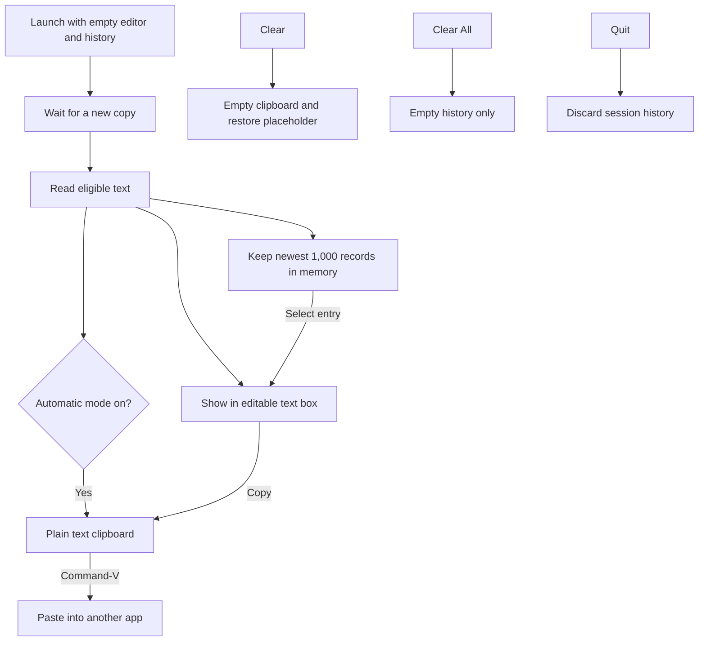

# Kopier

A native macOS clipboard editor that removes rich text formatting. All processing stays local.

## Use

Open `Kopier.app`. The 460 × 460 window starts with an empty editor and the placeholder “Copy any text and it will show here.” Your existing system clipboard stays untouched until a new copy occurs.

1. Copy text from any app. Kopier shows it in the editor and adds it to history.
2. Edit it if needed, then click **Copy**.
3. Return to your destination and press **Command-V**.

Automatic formatting removal starts checked. Fonts, colors, and rich text styles are removed; words, Unicode, and line breaks are preserved. Literal Markdown or HTML source remains text. Images and file copies without text are left alone. Common password-manager private clipboard markers are respected.

**Clear** empties the system clipboard and editor, restoring the placeholder. It keeps history. **Show History** opens the drawer; selecting an entry loads it into the editor so you can edit and **Copy** it. **Clear All** empties history only. **Hide History** closes the drawer.

History holds at most 1,000 text copies in memory, newest first, and discards the oldest when full. Quitting clears it. Nothing is saved to disk or sent over the network. Reusing an entry does not add a duplicate record. Entries wrap and resize with the window; separators appear only on actual entries.

Click the pixel copier in the menu bar or the Dock icon to reopen the window. Quit with **Kopier → Quit Kopier**, **Command-Q**, or the Dock menu. Kopier does not paste into other apps automatically or require Accessibility permission.

## Operation



## Build

Requires macOS with Apple's Swift command line tools or Xcode. No third-party dependencies.

```sh
./build.sh
open Kopier.app
```

The build regenerates the pixel copier assets using `Scripts/MakeIcon.swift`, packages `Kopier.app`, and signs it locally. It is not notarized for public distribution. The color icon is used for the app and its monochrome version for the menu bar.

## History checks

```sh
cat Source/ClipboardHistory.swift Tests/HistoryTests.swift > /private/tmp/kopier-history-tests.swift
swift -module-cache-path /private/tmp/kopier-module-cache /private/tmp/kopier-history-tests.swift
```

Checks cover the cap, ordering, eviction, fresh sessions, clearing, and Unicode preservation.
