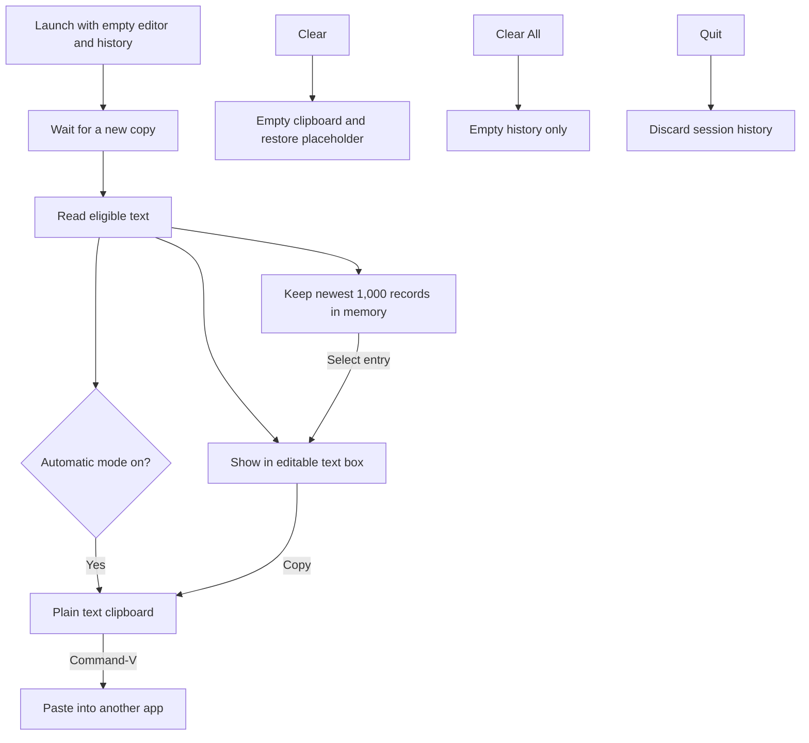

# Kopier

A native macOS clipboard editor that removes rich text formatting. All clipboard processing stays local.

## Use

Open `Kopier.app`. The 460 × 460 window starts with an empty editor and the placeholder “Copy any text and it will show here.” Your existing system clipboard stays untouched until a new copy occurs.

1. Copy text from any app. Kopier shows it in the editor and adds it to history.
2. Edit it if needed, then click **Copy**.
3. Return to your destination and press **Command-V**.

**Automatically remove formatting** starts checked. Fonts, colors, and rich text styles are removed; words, Unicode, and line breaks are preserved. Literal Markdown or HTML source remains text. Images and file copies without text are left alone. Common password-manager private clipboard markers are respected.

**Clear** empties the system clipboard and editor, restoring the placeholder. It keeps history. **Show History** opens the drawer; selecting an entry loads it into the editor so you can edit and **Copy** it. **Clear All** empties history only. **Hide History** closes the drawer.

History holds at most 1,000 text copies in memory, newest first, and discards the oldest when full. Quitting clears it. Nothing is saved to disk or sent over the network. Reusing an entry does not add a duplicate record. Entries wrap and resize with the window; separators appear only on actual entries.

**Kopier → About Kopier** shows the app icon, name, version, and release date on separate centered lines.

Click the pixel copier in the menu bar or the Dock icon to reopen the window. Quit with **Kopier → Quit Kopier**, **Command-Q**, or the Dock menu. Ordinary clipboard use does not require Accessibility permission.

**Kopier → Check for Updates…** uses Sparkle to check the GitHub-hosted release feed. Available updates download, verify their signature, and install inside the app, with a relaunch when you approve. Incremental patches are used when available, with a full-download fallback. Checks are manual; background checks, automatic installation, and system profiling are disabled. Clipboard text and history never enter the updater.

## Paste like typing

**Paste like typing** starts off. Enable it and use the compact speed slider to the right of the checkbox, from **Slow** to **Fast**. The slider appears only while **Paste like typing** is checked. The speed changes continuously from deliberate typing (about 220 ms per character) to nearly instant typing (about 1 ms per character), plus natural pauses. Click **Copy**, focus the destination text field, and press **Command-V** as usual. Kopier replaces that paste with the current clipboard text typed character by character with varied timing and longer pauses between words, at punctuation, and at line breaks. The Copy button still updates the clipboard. Speed changes apply to the next run. **Keyboard Sound** appears only while **Paste like typing** is checked. It starts checked; uncheck it for silent typing. The quiet key taps are edited excerpts from [Keyboard Typing by Trollarch2 (Freesound), via Pixabay](https://pixabay.com/sound-effects/technology-keyboard-typing-5997/), included under the Pixabay Content License. Source details and reproduction instructions are in `Assets/Keyboard/README.md`. They play through the system default audio output only during the typing paste and stop immediately when sound is unchecked or the paste is cancelled. No instruction text appears when the option is enabled.

This optional mode requires permission in **System Settings → Privacy & Security → Accessibility**. Enabling the checkbox checks access silently and requests it at most once per launch if needed; after granting Kopier access, check the option again. Press **Escape**, return to Kopier, or switch apps to stop. Unchecking the option or clicking Clear also cancels. Copy never starts typing, and there is no countdown. With the option off, Command-V behaves normally. Pasting inside Kopier, modified shortcuts such as Command-Shift-V, and private or non-text copies use normal paste behavior. Repeated Command-V presses during typing are ignored. Text stays local and the typing session is discarded when stopped or finished.

If Kopier is already enabled in Accessibility but still reports blocked access, the entry may belong to an older build or another copy. Quit Kopier, remove its old entry with the minus button in **System Settings → Privacy & Security → Accessibility**, then add the exact app you launch and enable it. For local development that is `Kopier-dev.app` inside the repository folder, listed separately as **Kopier-dev**. Reopen that same app and enable **Paste like typing**. Quitting clears session history. This refresh affects only Kopier; no full privacy reset is needed.

Local builds use ad-hoc signing by default. Their signing identity changes when the executable changes, which can invalidate the previous permission. To keep a stable identity across builds, use an installed Apple Development or Developer ID Application certificate:

```sh
KOPIER_SIGNING_IDENTITY="Apple Development: Your Name (TEAMID)" ./build.sh
```

Use the same certificate and app location on subsequent builds. The first switch from ad-hoc signing still requires approving the newly signed app.

Use a destination that accepts ordinary text input. Some apps handle simulated Unicode keystrokes differently. Line breaks and tabs are sent as text; destination behavior can vary. Try a short sample before a demo.

## Operation



## Build

Requires macOS 13 or later with Apple's Swift command line tools or Xcode. Sparkle 2.10.1 is the only third-party dependency. The first build downloads its official binary distribution and verifies a pinned SHA-256 checksum; later builds reuse the local `.build/` cache.

```sh
./build.sh
open Kopier-dev.app
```

The build regenerates the pixel copier assets using `Scripts/MakeIcon.swift`, packages `Kopier-dev.app` with a separate `local.kopier.dev` identity, and signs it locally. Its window, Dock name, menu, and Accessibility entry are labeled **Kopier-dev**, and release update checks are disabled. It can coexist with the installed release. Enable typing mode in only one copy at a time so both do not intercept Command-V. It is not notarized for public distribution. The color icon is used for the app and its monochrome version for the menu bar.

To build the release app as `Kopier.app`, use `./build.sh --release`. `Scripts/PrepareRelease.sh` always selects this release mode; downloaded releases keep the name **Kopier** and the existing `local.kopier.app` identity. Local and release builds require separate Accessibility approvals.

## History checks

```sh
cat Source/ClipboardHistory.swift Tests/HistoryTests.swift > /private/tmp/kopier-history-tests.swift
swift -module-cache-path /private/tmp/kopier-module-cache /private/tmp/kopier-history-tests.swift
```

Checks cover the cap, ordering, eviction, fresh sessions, clearing, and Unicode preservation.

Typing mode checks use a separate temporary clipboard:

```sh
cat Source/TypingPaste.swift Tests/TypingPasteTests.swift > /private/tmp/kopier-typing-tests.swift
swift -module-cache-path /private/tmp/kopier-module-cache /private/tmp/kopier-typing-tests.swift
```

These check one composed character per typing step, exact text reconstruction and normal-paste fallback for private and non-text clipboard items. Intercepting Command-V and typing into another app should also be tried manually with Accessibility permission enabled.

## Release 0.4-beta

Adds a compact continuous Slow–Fast slider beside **Paste like typing**, visible only while enabled, with speeds up to nearly instant. Adds an optional **Keyboard Sound** checkbox using quiet excerpts from the selected Pixabay recording. Removes the instruction text and shortens the formatting checkbox label. Local builds are now **Kopier-dev.app**, with a separate identity; release builds remain **Kopier.app**.

## Release 0.3-beta

Adds optional character-by-character typing on Command-V, with Slow, Normal, and Fast speeds and natural pauses. Accessibility permission is required only for this mode; local rebuilds may require refreshing its system permission. Permission prompts are limited to once per launch.

## Release 0.2-beta

The GitHub release includes an Apple Silicon app archive. Requires macOS 13 or later. The beta is locally signed and is not Developer ID signed or notarized.

## Preparing updates

`ReleaseConfig.plist` holds the display version, release date, increasing build number, public update-signing key, and feed URL. Increment both versions for every release; never reuse a build number. The app’s bundle identifier stays `local.kopier.app` so updates preserve its identity.

The private update-signing key lives in the login Keychain under the Sparkle account `local.kopier.app`. Keep a secure backup using Sparkle’s `generate_keys` tool; never commit or upload the private key. A new checkout on another Mac needs that same key imported before preparing releases. Only the public key is committed.

```sh
./Scripts/PrepareRelease.sh v0.2-beta
```

The script builds and verifies the app, creates a ZIP named `Kopier-VERSION-macos-ARCH.zip` (for example `Kopier-0.2-beta-macos-arm64.zip`), signs it, and generates `releases/appcast.xml`. Retain previous ZIPs and the prior appcast in the ignored `releases/` folder so Sparkle can generate signed delta patches. It does not publish anything. Upload the new ZIP, appcast, and new `.delta` files to the matching GitHub release. Publish updater releases as regular GitHub releases: the feed uses GitHub’s `/releases/latest/download/appcast.xml`, which excludes GitHub prereleases. The app’s display version can still contain `-beta`.

The first Sparkle-enabled version must be installed manually by existing 0.1-beta users. Subsequent releases can update in the app. Until the first feed is published, update checks report a feed error. Test installation between two distinct builds before distributing; delta generation alone does not verify the full installed update flow.

Local builds are ad-hoc signed unless `KOPIER_SIGNING_IDENTITY` is set. Developer ID signing and notarization are still recommended for public distribution; integrating Sparkle does not provide those credentials. The embedded Sparkle framework and helpers retain their upstream signatures.
